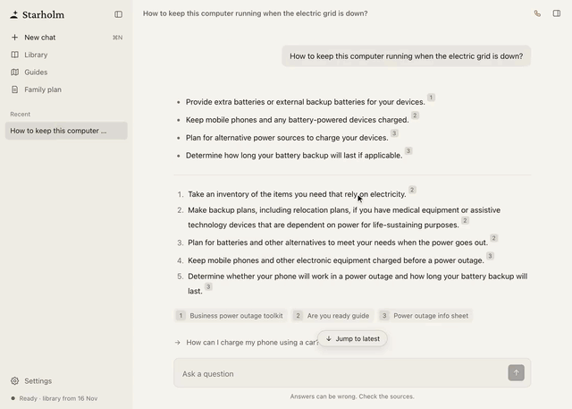

<h1 align="center">
  <picture>
    <source media="(prefers-color-scheme: dark)" srcset="docs/images/starholm-logo-dark.svg">
    
  </picture>
</h1>

<p align="center">
  <strong>Emergency guides, manuals and a private AI assistant, kept on your own computer.<br>
  It works with no internet, and nothing you ask leaves your computer.</strong>
</p>

<p align="center">
  <a href="https://starholm.app/download"><strong>Download for Mac</strong></a> ·
  <a href="https://starholm.app/download">Windows coming soon</a> ·
  <a href="https://starholm.app">Website</a> ·
  <a href="https://starholm.app/upgrade">Pricing</a> ·
  <a href="https://starholm.app/models">How we choose models</a>
</p>

<p align="center">
  
</p>

Ask a question, from a burn on your child's hand to how to make water safe. Starholm finds the right pages in a
library of over a million documents from sources like the CDC, FEMA, UK Medicines A to Z and Wikipedia, explains
them for your situation, and shows where every fact came from. You don't need an account, nothing tracks you, and there's no AI
subscription to pay.

## Why Starholm

- **It works when the internet doesn't.** The library, the guides and the assistant all live on your disk, so a
  storm, a power cut or a dead phone signal doesn't take them away.
- **It shows its sources.** Every answer lists the pages it used, and one click opens the page itself.
- **It stays private.** The assistant runs on your own computer through [Ollama](https://ollama.com). There's no
  account and no tracking, and nothing you ask is sent anywhere.
- **It's free and open source.** The app, three illustrated guides and the free library cost nothing. A one-time key
  adds the rest.

## What you get

| | Free and open source | Upgrade, a one-time key |
|---|---|---|
| **The app** | The assistant, search and the reader. You can switch the assistant off and just read. | The same app |
| **The library** | Downloaded from each publisher and built on your computer. It takes several hours and keeps every page as published, clutter included. | The same sources cleaned and checked, in one download of about 16 GB |
| **Guides** | Three illustrated guides: CPR and choking; bleeding, burns and heat stroke; and leaving home in a hurry | Every guide, with booklets to print and fold, and the emergency pack |
| **Emergency numbers** | 24 countries, each checked against an official page, with a wallet card to print | The same |
| **Your own documents** | Searched beside the library | The same |
| **Maps** | Not included | Offline street maps by region |
| **Family plan** | Not included | Who to call and where to meet, printed for the fridge and as wallet cards |

The key is checked on your computer, with no account. One key covers up to three computers in your household and
never expires. Prices are on the [pricing page](https://starholm.app/upgrade).

## Get started

Most people should [download the app](https://starholm.app/download) for Mac and start here. Windows is coming soon.

<details open>
<summary><strong>Install on a Mac</strong></summary>

Starholm needs a Mac with Apple silicon (M1 or later) and macOS 14 Sonoma or newer. The download holds everything
it needs, so you don't install Python, Homebrew or anything else first.

1. Open the Starholm `.dmg` file from your Downloads folder, then drag **Starholm** onto the **Applications** folder in the
   window that opens.
2. Open Starholm from your Applications folder. The app isn't signed by Apple yet, so the first time macOS shows a
   warning that it can't check Starholm and doesn't open it. Click **Done**. Don't click Move to Trash.
3. Open the **Apple menu › System Settings**, click **Privacy & Security** in the sidebar, and scroll down to
   **Security**. Next to the line saying Starholm was blocked, click **Open Anyway**. The button is there for about
   an hour after you tried to open the app; if it's gone, open Starholm again and come back.
4. Enter your login password (or use Touch ID) and click **OK**.
5. The warning appears once more, now with a button to open it. Click **Open**.

You only do this once. From then on Starholm opens like any other app. On macOS 15 Sequoia and later, Control-click ›
Open no longer skips the warning, so use the steps above.

Starholm keeps your library, maps, chats, notes and settings in `~/Library/Application Support/Starholm`, never
inside the app. Replacing the app with a new version keeps them. To remove Starholm completely, drag the app to the
Trash and delete that folder.

</details>

<details>
<summary><strong>Install on Windows (not released yet)</strong></summary>

The Windows version isn't released yet. These steps are for when it is.

Starholm needs a 64-bit PC with Windows 10 version 22H2 or Windows 11. The download holds everything it needs, so
you don't install Python or anything else first. It installs for your Windows account only and doesn't ask for an
administrator password.

1. Open `Starholm-Setup.exe` from your Downloads folder.
2. The installer isn't signed yet, so Windows shows a blue box saying **Windows protected your PC**. Click
   **More info**, check that the app is Starholm, then click **Run anyway**. If your browser warns about the download
   first, choose to keep it.
3. Click through the installer. It puts Starholm in your Start menu and opens it when it finishes.

You only do this once. Starholm opens in its own window, which uses Microsoft Edge's WebView2. That comes with
Windows 10 22H2 and Windows 11; if it's missing, Starholm opens in your web browser instead. Booklets and printable
PDFs aren't available on Windows yet: open a guide and press Ctrl+P to print it.

Starholm keeps your library, maps, chats, notes and settings in `%LOCALAPPDATA%\Starholm`, never in its install
folder. Installing a new version keeps them. To remove Starholm completely, uninstall it from **Settings › Apps**,
then delete that folder.

</details>

1. **Pick a model.** Settings › Model shows the models we recommend and downloads the one you pick through Ollama.
   [How we choose models](https://starholm.app/models) explains the choice. With no model, Starholm still searches the
   library and opens every page.
2. **Get a library.** The Library tab offers the free library, built on your computer from the original publishers,
   or the ready-made library from the upgrade. Both show their size before anything downloads.
3. **Check your emergency numbers.** Settings › Emergency numbers guesses your country from your computer's time zone.
   Pick another if it's wrong, and print the wallet card.

<details>
<summary><strong>Build it from this repository (Mac)</strong></summary>

These steps are for Macs with Apple silicon.

1. Install [Homebrew](https://brew.sh), then Python 3.13, Poppler (for reading PDFs) and [Ollama](https://ollama.com)
   (which runs the AI model):

   ```bash
   brew install python@3.13 poppler ollama
   ```

2. Get the code:

   ```bash
   git clone https://github.com/starholm-app/starholm.git
   cd starholm
   ```

3. Create the Python environment with the three install commands at the top of
   [requirements.lock](requirements.lock), run from this folder in order. They install only the exact package files
   listed there, checked against their hashes.

4. Build the app into `~/Applications`. This compiles a small launcher with the Xcode Command Line Tools. Homebrew
   installs them for you:

   ```bash
   ops/make-app.sh
   ```

   Or run it without building, in your web browser:

   ```bash
   .venv/bin/python app/server.py --browser
   ```

Run the tests with `.venv/bin/python tests/run_all.py`. They run without a model or a library.

</details>

## Questions

### Do I need the internet?
Only to download things: the app, a library, a model, maps or the upgrade. After that, everything works offline.

### Do I need to pay?
No. The app, the assistant, three guides, the emergency numbers and the free library are free. The upgrade saves the
hours of building the library yourself and adds every guide, the maps and the family plan.

### Which AI model does it use?
The one you pick in Settings, run by Ollama on your own computer. The [models page](https://starholm.app/models)
explains which models we recommend and why.

### Can I use it without the AI?
Yes. Switch the assistant off and Starholm is a searchable offline library and a set of guides.

### Which computers does it run on?
Macs. Windows is coming soon. The [download page](https://starholm.app/download) lists what each one needs. There's no phone
app yet.

## Privacy

The app connects to nothing while you use it. It talks only to Ollama on your own computer, and a link you click
opens in your own browser. It goes online only when you download a library, a model, maps or the upgrade, and when
you press Check for updates. If you turn on "Download updates automatically" in Settings, it also checks for a new
version when it opens and every hour while it is open; that check sends nothing about you or your key. Chats and
notes are plain files on your disk, so turn on disk encryption (FileVault on a Mac, BitLocker or Device Encryption on
Windows) to keep them safe if the computer is lost.

## License and credits

The code is under the [MIT License](LICENSE). Every library source keeps its own license, listed in
[SOURCES.md](SOURCES.md). Library sources are packaged for offline use by Kiwix and openZIM.
[THIRD_PARTY_NOTICES.md](THIRD_PARTY_NOTICES.md) covers the maps, fonts and code
libraries Starholm uses.

Starholm grew from ideas in several open projects, among them [Kiwix](https://kiwix.org),
[Survival LLM](https://www.brangus.io/survival-llm), [Project NOMAD](https://www.projectnomad.us) and the
[World Factbook Archive](https://worldfactbookarchive.org). Thank you to everyone who writes and shares the guides,
manuals and articles in the library.

## Medical and safety

> [!IMPORTANT]
> Starholm is not medical advice, and no doctor has reviewed its guides or answers. In an emergency, call your local
> emergency number first, and follow your national health authority. Read the
> [medical and safety note](docs/medical-and-safety.md) before you rely on it.

<p align="center">
  <a href="https://starholm.app">starholm.app</a> · <a href="https://starholm.app/download">Download</a>
</p>
