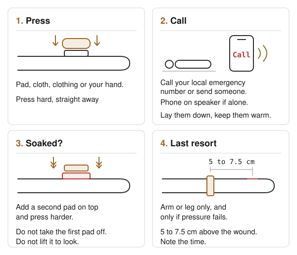
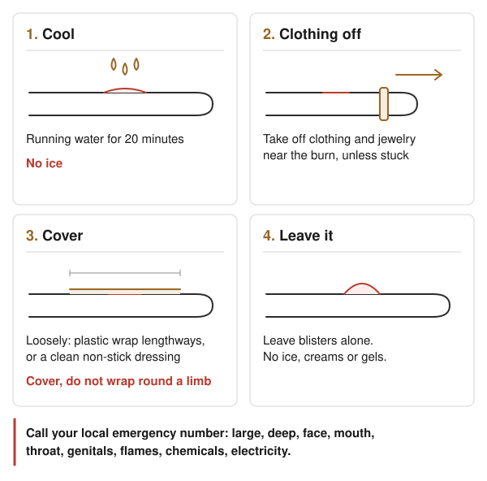
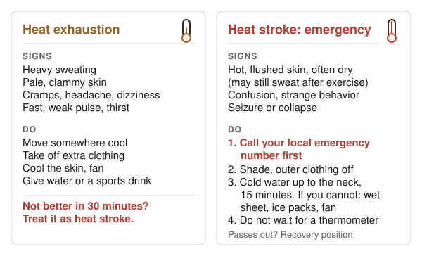

# Bleeding, burns and heat stroke

- [Severe bleeding](#severe-bleeding): pressure first, and [when a tourniquet is the last resort](#tourniquet)
- [Burns](#burns): cool for 20 minutes, and [when to call](#burns-when-to-call-for-help)
- [Heat exhaustion and heat stroke](#heat-exhaustion-and-heat-stroke): the signs and how to cool someone fast

> [!warning]
> Call your local emergency number for bleeding that is heavy or won't stop, for a large or deep burn, and for anyone who is hot, confused or has collapsed.

## Severe bleeding

Bleeding is severe if blood flows, pools or soaks through a bandage. Even a cupful can make someone get worse fast.

1. **Press hard and straight away.** Use a pad, clean cloth, clothing or your hand. Protect yourself with gloves or a plastic bag if you have them. If the person can, ask them to press on their own wound.
2. **Call your local emergency number,** or send someone. If you're alone, put the phone on speaker and keep pressing.
3. **Lay the person down** and keep them warm. Heavy bleeding can cause shock.
4. **If blood soaks through,** put a second pad over the first and press harder. Don't take the first one off, and don't lift it to look.
5. **Once the bleeding stops,** bandage firmly, but not so tight that it cuts off the blood below. Press a nail beyond the bandage for 5 seconds and let go. If the color doesn't return within 2 seconds, loosen the bandage.
6. If an object is stuck in the wound (a knife, a stick), **leave it in.** Press around it.

Don't press on "pressure points" to stop severe bleeding. IFRC advises against it.

### Tourniquet

Use one only for bleeding from an arm or leg that is life-threatening and that direct pressure hasn't stopped.

- A manufactured tourniquet is preferred. An improvised one (a wide bandage, a belt or a tie) is less effective but may be used if it's all you have.
- Put it 5 to 7.5 cm (2 to 3 inches) above the wound, not on a joint. Put it over clothing if you can.
- To make one, wrap a bandage 5 to 10 cm wide round the limb several times and tie a knot. Put a stick on the knot, tie a second knot over it, and twist the stick until the bleeding stops.
- It's very painful, and the person may try to remove it.
- Write down the time you put it on. Leave it in place until help arrives.

> [!note]
> MedlinePlus says tourniquet pressure must be relieved from time to time. IFRC says to leave it on until help arrives. We follow IFRC.

## Burns

1. **Cool the burn now** with clean running water for 20 minutes. If there's no running water, use any cool drink such as milk or juice.
2. **Take off** clothing and jewelry near the burn, before it swells, unless they're stuck to the skin.
3. **Cover** the cooled burn loosely with plastic wrap (cling film), laid lengthways, or a clean non-stick dressing. A limb may swell, so don't wrap the covering round it.
4. **Leave blisters alone.** Don't put ice, creams or gels on it.
5. If the burn is large, **lay the person down** and keep them warm, in case of shock.

Four kinds of burn need something different:

- **If clothes are on fire,** stop, drop and roll (see [fire at home](guide:fire-at-home-or-in-your-building#if-your-clothes-catch-fire)).
- **For a chemical burn,** rinse with running water until the pain eases.
- **If a chemical gets in the eye,** rinse at once with clean water, take out contact lenses, and don't let the person drive.
- **For an electric burn,** switch off the power if you can do so safely. Don't touch the person directly. Move them away from exposed wires with something that is not metal.

### Burns: when to call for help

Call your local emergency number if the burn is large or deep, is near the face, mouth, throat or genitals, or came from flames, chemicals or electricity. Get medical advice for any burn on a baby, an older person or someone with diabetes. New warmth, pain or a fever around the burn later means infection.

> [!note]
> The sources differ on cooling time. IFRC says at least 10 minutes, ideally 20. St John Ambulance says at least 20. MedlinePlus says 5 to 30. We use 20. IFRC also allows petroleum jelly or honey on a cooled burn. We leave them out because St John Ambulance advises no creams.

## Heat exhaustion and heat stroke

A person with **heat exhaustion** has heavy sweating, pale and clammy skin, cramps, headache, dizziness, a fast weak pulse and thirst.

1. Move them somewhere cool and take off extra clothing.
2. Cool the skin with water and a fan, or cold packs wrapped in cloth on the neck and armpits.
3. Give water or a sports drink.
4. If they're not better within 30 minutes, treat it as heat stroke.

**Heat stroke** is an emergency. Look for hot, flushed skin that is often dry, confusion or strange behavior, a seizure or a collapse. After hard exercise they may still be sweating, so confusion, a seizure or a collapse is enough. Call your local emergency number if they stop sweating or their temperature is above 39 °C, but don't wait for a thermometer.

1. **Call your local emergency number first.**
2. Move them somewhere cool and shaded and take off outer clothing.
3. **Cool them as fast as you can.** Wherever possible, put them in cold water up to the neck for about 15 minutes, or until their temperature is below 39 °C. If you can't, wrap them in a cool wet sheet, or wet their skin with cold water and fan them, with ice packs on the neck, armpits and groin.
4. Give a drink only if they're alert and can drink without vomiting.
5. If they pass out, put them in the recovery position, check their breathing, and start CPR if there's no sign of life (see [CPR and choking](guide:cpr-and-choking)).

In IFRC's review, fanning alone didn't cool significantly faster than doing nothing, so wet the skin as well. The US Army calls delay in cooling the single most important factor leading to death or lasting disability.

## What not to do

> [!danger]
> - Don't take a soaked pad off a wound, or pull out an object stuck in it.
> - Don't put ice or ice-cold water on a burn, or break blisters.
> - Don't use a tourniquet anywhere but on an arm or a leg.
> - Don't delay cooling a heat stroke patient while you wait for a thermometer.

## Sources

- IFRC, International First Aid, Resuscitation and Education Guidelines 2020, topics "Severe bleeding", "Burns", "Environmental: Hyperthermia", "Shock". www.ifrc.org/sites/default/files/2022-02/EN_GFARC_GUIDELINES_2020.pdf, in the library.
- MedlinePlus (NIH), "Bleeding" (including "When to use a tourniquet"), "Burns", in the library.
- St John Ambulance, "Severe bleeding", reviewed 8 September 2026; "Burns and scalds", reviewed 28 April 2025. www.sja.org.uk/first-aid-advice/ (checked 13 November 2026)
- NHS, "Heat exhaustion and heatstroke", last reviewed 28 May 2026. www.nhs.uk/conditions/heat-exhaustion-heatstroke/ (checked 13 November 2026)
- Emirates Health Services, "Heat Exhaustion". www.ehs.gov.ae/en/awareness/seasonal-health/heat-exhaustion (checked 13 November 2026)
- U.S. Army, TB MED 507, Heat Stress Control and Heat Casualty Management, 12 April 2022, chapter 5, in the library.

## Read next

- [CPR and choking](guide:cpr-and-choking)
- [Fire at home or in your building](guide:fire-at-home-or-in-your-building)
- [No electricity](guide:no-electricity)
