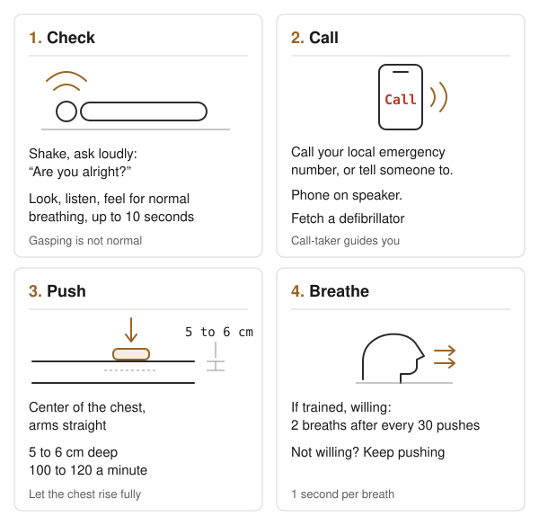
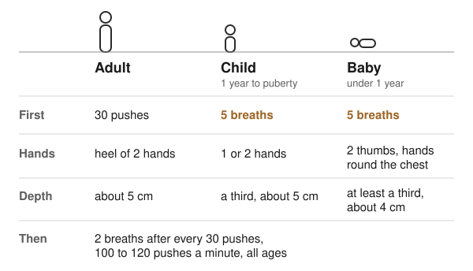
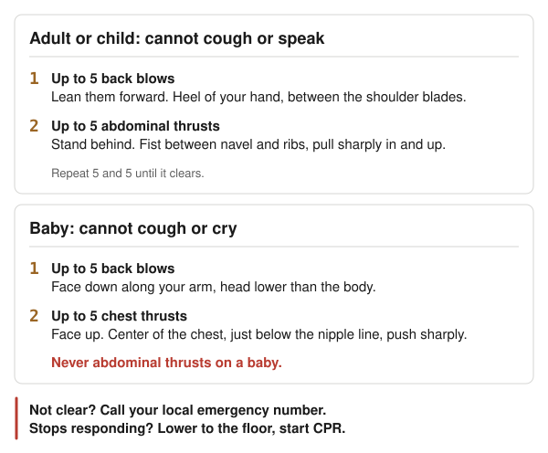

# CPR and choking

- [CPR for an adult](#cpr-for-an-adult)
- [Using a defibrillator (AED)](#using-a-defibrillator)
- [CPR for a child or a baby](#cpr-for-a-child-or-a-baby)
- [Choking: adult or child](#choking-adult-or-child) and [choking: baby](#choking-baby)
- [Pulled from water](#pulled-from-water) and [what not to do](#what-not-to-do)

> [!warning]
> Call your local emergency number for anyone who does not respond and is not breathing normally, or who is choking and cannot cough, speak or breathe. Put the phone on speaker.

## CPR for an adult

1. **Shake their shoulders and ask loudly, "Are you alright?"** If there's no response, tilt the head back, lift the chin, and look, listen and feel for normal breathing for up to 10 seconds. Gasping, noisy or irregular breaths aren't normal. If in doubt, treat it as not normal.
2. **Call your local emergency number,** or tell someone to. If you're alone, call and put the phone on speaker. The call-taker will guide you. Ask someone to fetch a defibrillator.
3. **Push** in the center of the chest, on the lower half of the breastbone: the heel of one hand, the other hand on top, arms straight. Push about 5 cm deep (not more than 6 cm), 100 to 120 times a minute, and let the chest come fully up each time. A firm surface is best.
4. **Give 2 breaths after every 30 pushes,** if you're trained and willing. Tilt the head, pinch the nose and blow into the mouth for about 1 second, until the chest rises. Take under 10 seconds. If you can't or won't give breaths, push without stopping.
5. **Swap** every 1 to 2 minutes if someone can take over, with no pause.
6. **Stop** only when help takes over, the defibrillator tells you to, or the person coughs, opens their eyes, speaks, moves on purpose and breathes normally.

You're very unlikely to make things worse by trying. If the person is unresponsive but breathing normally, don't push on the chest. Turn them onto their side with the head tilted back (the recovery position) and call your local emergency number.

## Using a defibrillator

- Anyone can use one. It gives voice prompts, and you put the pads where the pictures on them show.
- Keep doing CPR while it's set up. Pause only when it's ready to analyze, and don't touch the person then.
- After a shock, start pushing again at once.
- For a baby or child under about 8 years (25 kg), use child mode or child pads if there are any. If there are none, use the adult setting.

## CPR for a child or a baby

A baby is under about one year. Treat anyone who looks like a teenager or adult as an adult.

1. **Call your local emergency number** on speaker, or send someone. If you're alone and have no phone, do steps 2 to 4, then after 1 minute of CPR go and call, taking a small child with you.
2. **Open the airway.** Tilt a child's head back, keep a baby's head neutral, and lift the chin.
3. **Give 5 breaths first,** each about 1 second, until the chest rises. For a child, go mouth to mouth. For a baby, put your mouth over the baby's mouth and nose.
4. **Push 30 times** in the center of the chest, 100 to 120 a minute. For a child, push one third of the chest depth, about 5 cm, with one or two hands. For a baby, push at least one third of the chest depth, about 4 cm, with two thumbs and your hands around the chest.
5. **Give 2 breaths.** Repeat 30 pushes and 2 breaths until help arrives or the child shows signs of life. If you can't give breaths, push without stopping.

> [!note]
> The sources differ on the first step. IFRC says 2 to 5 breaths, the European Resuscitation Council and St John Ambulance say 5, and MedlinePlus starts with 30 pushes. We use 5. Don't delay starting.

## Choking: adult or child

If they can cough hard, speak or cry, the choking is mild. Encourage coughing and stay with them. A strong cough can clear it.

If they can't cough, speak or breathe, it's severe. They may clutch their throat or turn blue. Ask "Are you choking?"

1. Send someone to call your local emergency number. If you're alone, shout for help and start.
2. **Give up to 5 back blows.** Lean them forward, support their chest, and hit firmly between the shoulder blades with the heel of your hand.
3. **If that fails, give abdominal thrusts.** Stand behind them, put a fist between the navel and the ribs, grasp it with your other hand and pull sharply inwards and upwards, up to 5 times. Kneel for a child.
4. **Call your local emergency number now** if it isn't clear. Keep alternating 5 and 5.
5. If they become unresponsive, **lower them to the floor and start CPR.** The pushes may dislodge the object. Take out only what you can see.

For someone pregnant or obese, put your arms around the chest, a fist on the middle of the breastbone, and thrust firmly backwards. After severe choking, call your local emergency number even if the object comes out.

## Choking: baby

If the baby is coughing, the choking is mild. Wait and watch. If they can't cough, cry or breathe, it's severe.

1. **Back blows.** Lay the baby face down along your forearm, supported on your thigh or lap, head lower than the body. Give up to 5 firm blows between the shoulder blades.
2. **Chest thrusts.** Turn the baby face up and support the head. Push sharply down in the center of the chest, just below the nipple line, up to 5 times.
3. **Call your local emergency number now** if it isn't clear, taking the baby with you. Keep alternating 5 and 5.
4. If the baby becomes unresponsive, **start baby CPR.** Take out only what you can see.

After severe choking, call your local emergency number even if the object comes out. Every baby who had chest thrusts should be seen in hospital.

## Pulled from water

Don't go into deep water unless you're trained: reach with a long object or throw something that floats. If someone pulled out is unresponsive and not breathing, give 5 breaths first, then start CPR.

## What not to do

> [!danger]
> - Don't push on the chest of someone who is breathing normally.
> - Don't feel for a pulse before starting.
> - Don't sweep the mouth blindly with a finger.
> - Don't use abdominal thrusts on a baby.
> - Don't give a drink to someone who is choking.

## Sources

- IFRC, International First Aid, Resuscitation and Education Guidelines 2020, topics "Unresponsiveness", "Choking", "Unresponsive and abnormal breathing" (adult, baby and child, defibrillator). www.ifrc.org/sites/default/files/2022-02/EN_GFARC_GUIDELINES_2020.pdf, in the library.
- European Resuscitation Council, The ERC Guidelines 2025 on Resuscitation for Everyone, brochure at www.erc.edu/media/p5ymaeej/gl2025_layperson_book_ipdf-v11-e.pdf; launch date (22 October 2025) from www.erc.edu/science-research/guidelines/guidelines-2025/guidelines-2025-english/ (checked 13 November 2026)
- St John Ambulance, "How to do CPR", reviewed 18 September 2026; "Baby CPR" and "Child CPR", reviewed 24 September 2026; "Choking" and "Child choking", reviewed 28 April 2025; "Baby choking", reviewed 5 October 2026. www.sja.org.uk/first-aid-advice/ (checked 13 November 2026)
- MedlinePlus (NIH), "CPR - adult and child after onset of puberty", "CPR - young child", "CPR - infant", "Choking - adult or child over 1 year", "Choking - infant under 1 year", in the library.

## Read next

- [Bleeding, burns and heat stroke](guide:bleeding-burns-and-heat-stroke)
- [Fire at home or in your building](guide:fire-at-home-or-in-your-building)
