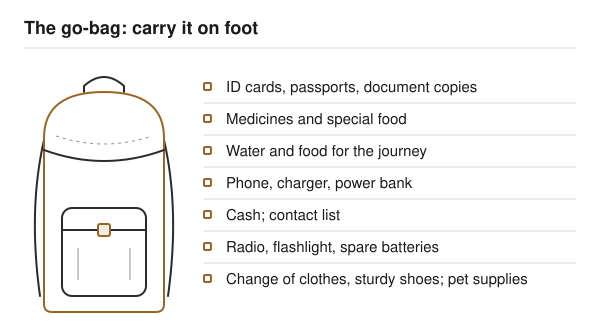
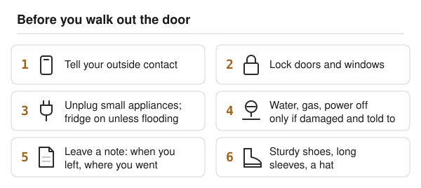

# Leaving home in a hurry

- [The go-bag to grab](#the-go-bag)
- [Before you walk out the door](#before-you-leave)
- [On the way](#on-the-way) and [at a reception center or shelter](#at-a-reception-center-or-shelter)
- [Plan ahead](#plan-ahead) where you would go and how, and [coming back](#coming-back)
- [Pets](#pets)
- See [prepare ahead](guide:prepare-ahead) for the full kit list

> [!warning]
> Leave at once when the authorities tell you to. In an emergency, call your local emergency number.

## The go-bag

Keep a bag you can carry on foot, ready in a known place:

- [ ] ID cards and passports, and copies of important documents in a waterproof folder.
- [ ] Your medicines, and any special food you need.
- [ ] Water and food for the journey.
- [ ] Phone, charger and power bank.
- [ ] Cash.
- [ ] Radio, flashlight and spare batteries.
- [ ] A change of clothes, sturdy shoes, a hat.
- [ ] A list of emergency and family contacts.
- [ ] For pets: food, water, leash or carrier.

Leave out heavy or bulky things that would slow you down. Make sure everyone at home knows where the bag is, and who takes it if you have to leave.

## Before you leave

If there is time:

1. Tell your contact outside the area where you are going.
2. Close and lock doors and windows.
3. Unplug radios, TVs and small appliances. Leave the fridge and freezer on unless flooding is likely.
4. Shut off water, gas and electricity if your home is damaged and you are told to.
5. Leave a note saying when you left and where you are going.
6. Wear sturdy shoes and clothes that protect you: long pants, long sleeves, a hat.
7. Check on neighbors who may need a lift.

## On the way

- Listen to a battery radio and follow the evacuation instructions.
- Use the routes you're told to use. Don't take shortcuts, because they may be blocked.
- Watch for washed-out roads, fallen power lines and flooded areas. Never drive into flood water.
- Leave early enough not to be trapped by bad weather.
- Take one car per family so the roads stay clear. You may have to go on foot.

## At a reception center or shelter

- Shelters often provide water, food, medicine and basic sanitary facilities.
- Take your own kit, even if the center gives food and water.
- Bring soap, hand sanitizer and wipes, because living with many people in a small space is hard.
- Many public shelters accept only service animals, so plan where your pet can go.

## Plan ahead

- Decide where you would go: the home of a friend or relative, or a designated shelter. Choose several places, such as a friend's home in another area or a hotel, in different directions.
- Work out more than one route out, and other ways to travel. Your route may have to be on foot.
- If you have no car, plan now how you would leave. Decide with family, friends or your local emergency management office what help is available.
- Sign up for official alerts, and know where you will get reliable information before, during and after a disaster.
- Keep at least half a tank of fuel at all times, and a full tank when an evacuation seems likely. Gas stations may be shut or without power.
- Keep a small kit in the car.
- Agree on a meeting place and an outside contact with your family, and update the meeting place as things change.
- Find out your local emergency, evacuation and shelter plans, and which shelters are open this year.

## Coming back

- Check with the officials where you are staying and back home before you travel. Return only when the authorities say it is safe.
- It's dangerous to come back before debris is cleared, and daily life may still be disrupted.
- Tell friends and family when you leave and when you arrive.
- Charge your devices and get back-up batteries in case power cuts continue. Fill up with fuel, and bring water and food for the journey.
- Keep away from fallen power lines. They may still be live. Report them to the electricity company.
- Run a generator only outside and away from the home, never indoors or in a garage.

## Pets

- Take your pets with you.
- Find out ahead of time where they can stay, since most public shelters allow only service animals.
- Pack pet food and water for three days.

## What not to do

> [!danger]
> - Don't wait to be trapped. Leave when told.
> - Don't take shortcuts off the official routes.
> - Don't drive into flood water or near fallen power lines.
> - Don't go back until the authorities say it is safe.

## When to call for help

If you can't leave on your own, turn to family, friends or your local emergency management office, as you planned. Call your local emergency number in an emergency.

## Sources

- Ready.gov (FEMA), "Evacuation", last updated 20 March 2026, in the library.
- Ready.gov (FEMA), "Shelter" (mass care shelters), last updated 24 September 2026, in the library. www.ready.gov/shelter (checked 21 November 2026)
- Ready.gov (FEMA), "Build A Kit", last updated 1 July 2026, in the library.
- National Emergency Crisis and Disaster Management Authority (NCEMA), Your Guide for Emergencies (2013), "The emergency kit", pages 120 to 123. www.ncema.gov.ae/content/documents/NCEMA%20Eng%20Daleel.pdf (checked 13 November 2026)
- Belgian National Crisis Center, "Un kit d'urgence à la maison" (pet food and water for 3 days). centredecrise.be/fr/que-pouvez-vous-faire/preparez-un-kit-durgence/un-kit-durgence-la-maison (checked 13 November 2026)

## Read next

- [Prepare ahead](guide:prepare-ahead)
- [No internet or phone network](guide:no-internet-or-phone-network)
- [Flooding and storms](guide:flooding-and-storms)
- [Fire at home or in your building](guide:fire-at-home-or-in-your-building)
